<p align="center">
  
</p>

<h1 align="center">BLEPulse</h1>

<p align="center">
  <strong>Native Android Bluetooth Low Energy 5.x Engineering Workstation</strong>
</p>

<p align="center">
  
  
  
  
  
  
</p>

<p align="center">
  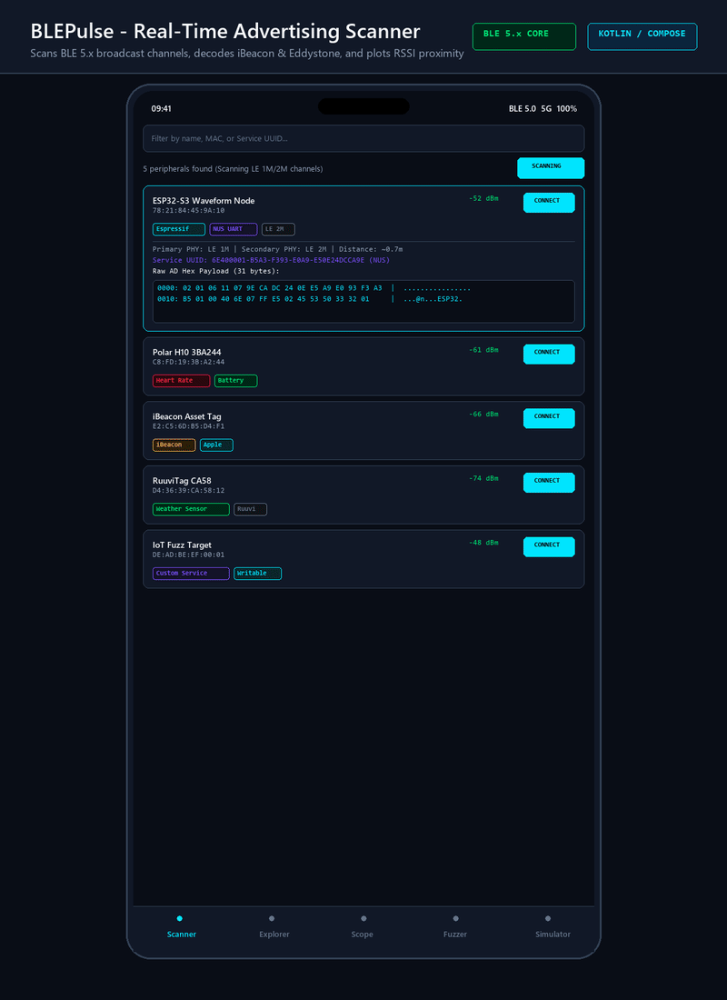
</p>

---

## Overview

Engineers and embedded firmware developers working with microcontrollers (ESP32, nRF52, STM32WB, RP2040) and Bluetooth Low Energy sensors require reliable tools to inspect advertising broadcasts, inspect GATT tables, stream telemetry, and flash firmware over the air. Existing mobile applications often carry ads, remain closed source, or lack automated security testing features.

BLEPulse provides an open-source, native Android engineering suite built with Kotlin, Jetpack Compose, and the Android Bluetooth LE Core API. It combines real-time broadcast parsing, interactive GATT read/write operations with type decoding, an embedded 60fps waveform oscilloscope, an FFT frequency spectrum analyzer, a bidirectional serial UART terminal, an audio/haptic Geiger proximity tracker, automated security auditing, GATT macro testing, and over-the-air firmware flashing into a single unified workstation.

---

## Core Tool Suite

### 1. Real-Time Advertising Scanner & Wireshark PCAP Exporter
- Decodes BLE 5.x primary and secondary physical layers (LE 1M, LE 2M, LE Coded).
- Protocol decoders:
  - **Apple iBeacon**: Proximity UUID, Major, Minor, Measured Power at 1 meter, and distance estimation via log-distance path loss.
  - **Google Eddystone**: UID (Namespace and Instance), URL (compressed prefix and TLD expansion), and TLM telemetry (battery millivolts, temperature, packet counter, uptime).
  - **Manufacturer Data**: Resolves 100+ Bluetooth SIG Company Identifiers (Apple, Nordic Semiconductor, Espressif, Microsoft, Google, Texas Instruments, STMicroelectronics).
- Signal tracking: Exponential Moving Average (EMA) smoothing for RSSI, historical sparklines, and proximity zones.
- **Wireshark PCAP Export**: Generates standard Libpcap 2.4 capture files (`LINKTYPE_BLUETOOTH_LE_LL` / DLT 251) with BTLE LL pseudo-headers, Access Address, and PDU lengths for desktop packet inspection.

### 2. Interactive GATT Explorer
- Built-in Bluetooth SIG Assigned Numbers database for standard services (Heart Rate, Battery, Environmental Sensing, Health Thermometer) and vendor services (Nordic UART Service NUS, TI SensorTag, ESP32 SPP).
- Sequential GATT command queue preventing dropped packets and Android status 133 connection errors.
- Multi-format data parser and editor: Hex, ASCII, UTF-8 strings, Binary bitfields, UInt8, UInt16 (LE/BE), UInt32 (LE/BE), Int8, Int16 (LE/BE), Int32 (LE/BE), Float32 (LE/BE), and IEEE 11073-20601 SFloat medical floats.
- Connection parameter negotiation: ATT MTU exchange (up to 517 bytes) and 2M PHY switching.
- Notification and indication subscription management via CCCD (0x2902) descriptors.

### 3. Live Waveform Oscilloscope & FFT Spectrum Analyzer
- Hardware-accelerated Canvas rendering engine operating at 60 frames per second.
- Multi-channel plotting for up to 4 simultaneous channels (3-axis accelerometer X/Y/Z, temperature, or cardiac signals).
- Scope parameters: Configurable rolling time windows (5s, 10s, 30s), center voltage baselines, auto-ranging Y-axis, and grid lines.
- **Real-Time FFT Spectrum Analyzer**: Radix-2 Cooley-Tukey Fast Fourier Transform engine decomposing sampled signals into frequency bins with selectable windowing (Hanning, Hamming, Blackman, Rectangular) and automated peak frequency tracking.
- Telemetry export: Direct export of captured time-series measurements as CSV files.

### 4. Bidirectional BLE Serial UART Terminal
- Auto-detects Nordic NUS (`6E400001-...`), ESP32 SPP (`0000ABF0-...`), and custom serial UART channels.
- Configurable line endings (CRLF, LF, CR, None) and display modes (ASCII text, raw Hex, or combined view).
- Command history buffer and one-tap macro presets (`AT+GMR`, `AT+BLEINIT=2`, `0xAA 0x55 0x01`, `PING`).
- Monospace terminal console with timestamped TX/RX indicators and auto-scroll locking.

### 5. Audio and Haptic Geiger Counter Proximity Tracker
- Maps dynamic RSSI values (-95 dBm to -35 dBm) to audio click frequencies (0.6 Hz to 25 Hz).
- Low-latency synthetic 1.5kHz PCM sine wave clicks generated via Android `AudioTrack` without external audio assets.
- Synchronized tactile haptic feedback via Android `Vibrator` for eyes-free peripheral hunting.
- Analog needle gauge with proximity zones (Immediate, Near, Far) and estimated distance in meters.

### 6. Chipset Fingerprinting & Automated Security Auditor
- Heuristic chipset identification based on MAC OUI prefixes, SIG Company Identifiers, and discovered GATT service profiles (detects ESP32-S3/C3, Nordic nRF52/53, TI CC26xx, Apple Silicon, and Ruuvi tags).
- Security vulnerability checks: Unauthenticated UART consoles, plain-text writable characteristics, write-without-response buffer exhaustion risks, and SweynTooth/BrakTooth vulnerability profiling.
- Automated security score calculation (0 to 100%) with actionable hardening recommendations.

### 7. GATT Macro Automation & Sequence Test Runner
- Programmable automation runner for hardware validation, commissioning, and manufacturing regression testing.
- Built-in test steps: `RequestMtu`, `RequestPhy`, `ReadCharacteristic`, `WriteCharacteristic`, `EnableNotification`, `WaitDelay`, and `AssertEquals`.
- Pre-loaded scenarios: Commissioning Test Suite and Nordic NUS Echo Round-Trip Test.
- Step-by-step checklist execution with latency tracking, status badges, and pass/fail statistics.

### 8. Nordic Secure DFU & ESP32 BLE OTA Flasher
- Dual-protocol over-the-air firmware update flasher supporting Nordic Secure DFU (`0xFE59` / `8EC87012-...`) and ESP32 BLE OTA (ESP-IDF / NimBLE).
- Binary image validator: Detects ESP32 bootloader headers (Magic `0xE9`), Nordic ZIP packages, and raw binaries.
- Calculates hardware CRC32 checksums and SHA-256 digests before flashing.
- Dynamic MTU negotiation, packet slicing, configurable inter-chunk pacing, and real-time transfer throughput metrics (kbps).

### 9. IoT Peripheral Security Fuzzer
- Automated boundary value testing: Zero-length buffers, single bytes, MTU edge cases (20, 23, 247, 512, 517 bytes), and fragmented oversized frames (600+ bytes).
- Mutation engine: Pseudorandom byte corruption, bit flipping, all-zero, and 0xFF byte saturation.
- Injection payloads: Format string specifiers (`%s%n%x`), null-byte delimiters, and illegal UTF-8 continuation bytes.
- Stress testing: High-speed consecutive write bursts to test microcontroller queue depth and RTOS task starvation.
- Anomaly detector: Flags unexpected GATT status errors and link terminations with exportable Markdown audit reports.

### 10. Virtual Peripheral Simulator
- Emulates a physical BLE 5.x peripheral server broadcasting custom advertisement packets.
- Pre-configured profiles: Heart Rate Monitor (0x180D), Battery Service (0x180F), Nordic UART loopback echo, and Environmental Sensing (0x181A).
- Central client monitor displaying peer MAC addresses, negotiated MTU, and incoming request logs.

### 11. Adaptive Form-Factor & Tablet Navigation
- Built with Jetpack Compose Material 3 responsive layout patterns (`BoxWithConstraints`).
- Automatically transitions between a compact bottom `NavigationBar` on portrait smartphones and an ergonomic vertical `NavigationRail` on tablets, foldables, and landscape orientations (`maxWidth >= 600.dp`).
- Multi-pane split layouts for FOTA flashing (firmware parameters on left, progress and transfer logs on right) and Geiger tracking (analog dial gauge on left, peripheral selector and feedback controls on right).

---

## Screenshots

<p align="center">
  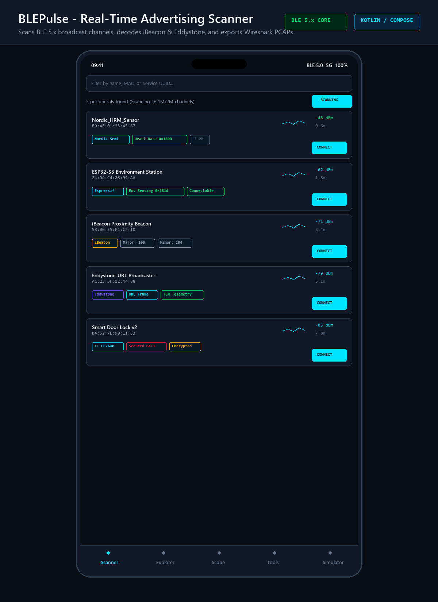
  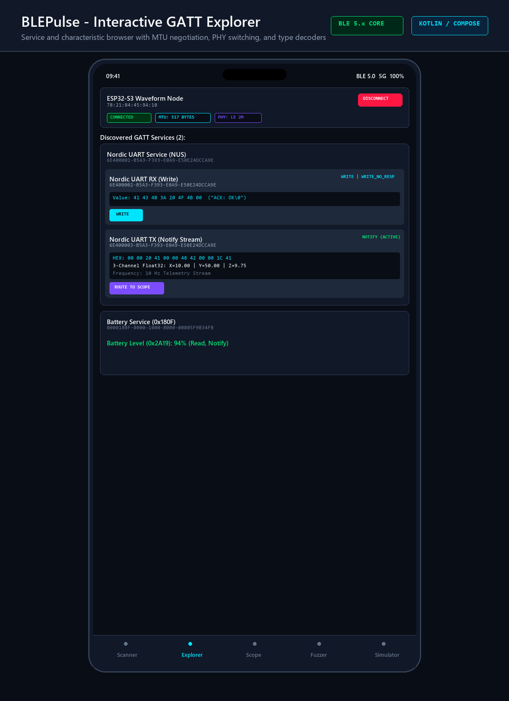
</p>

<p align="center">
  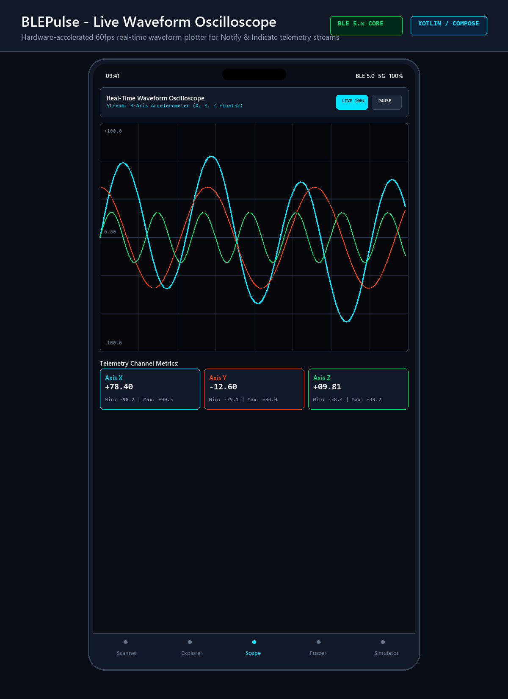
  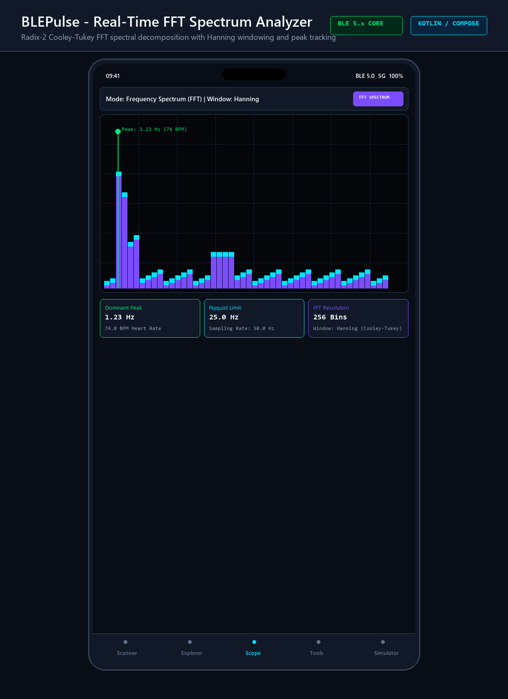
</p>

<p align="center">
  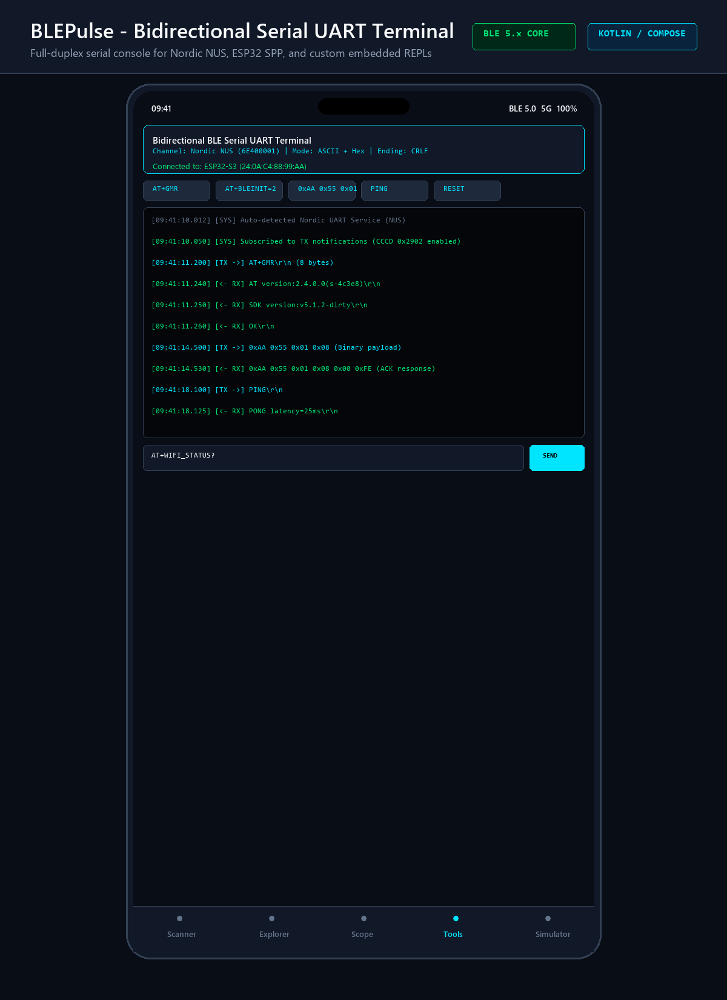
  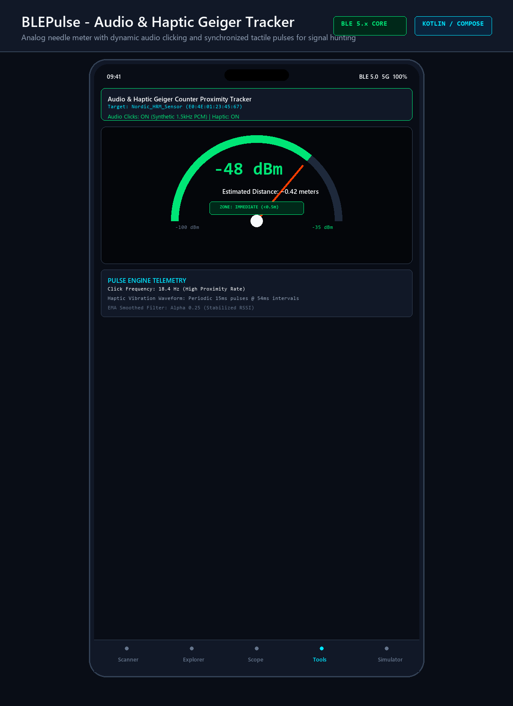
</p>

<p align="center">
  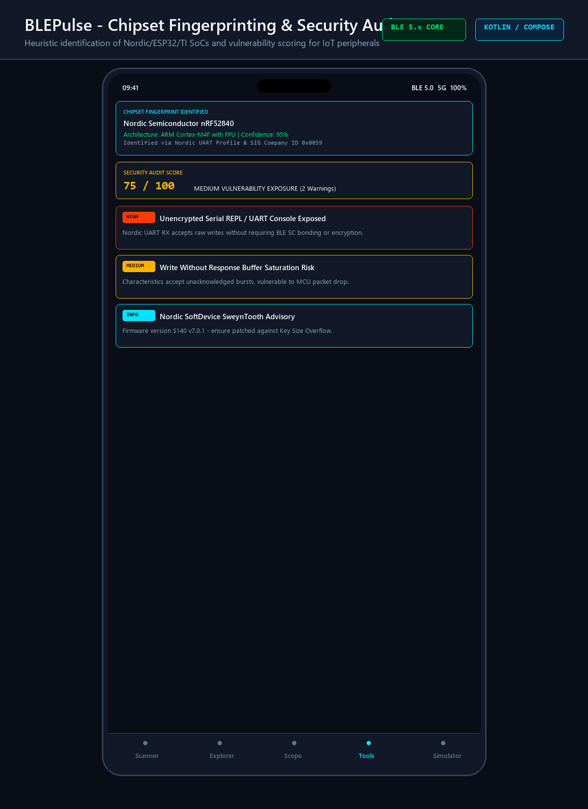
  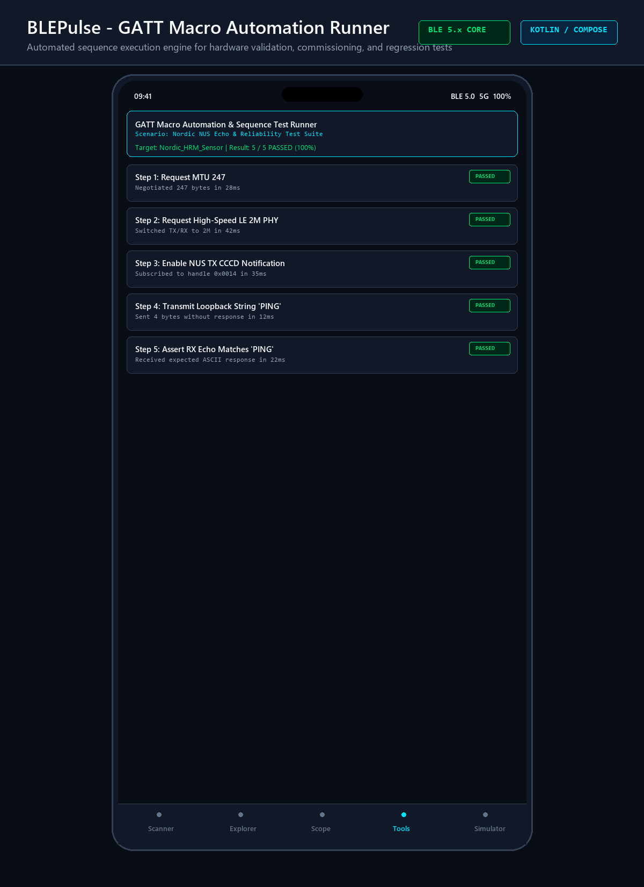
</p>

<p align="center">
  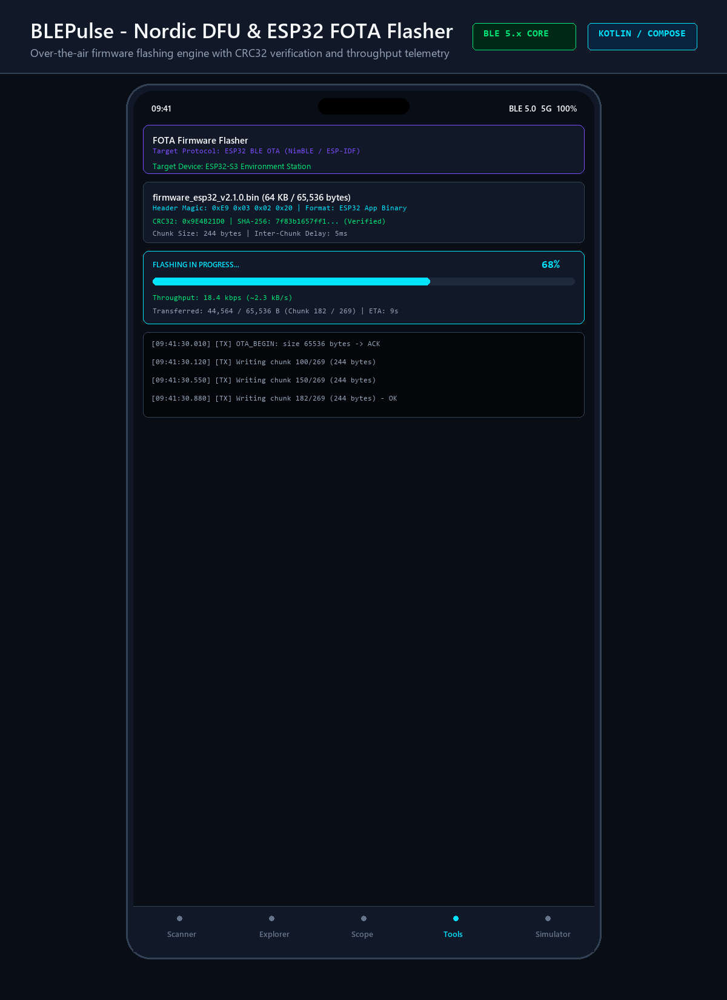
  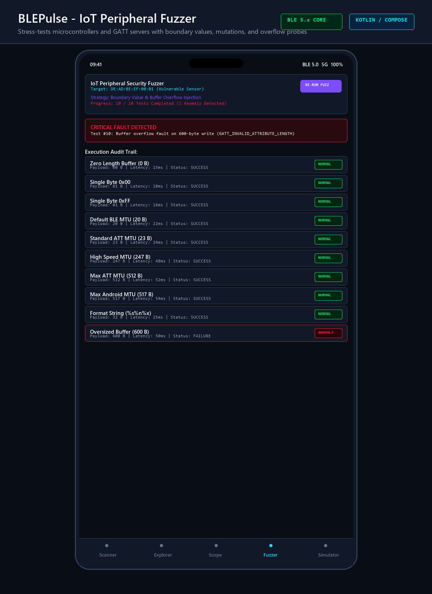
</p>

<p align="center">
  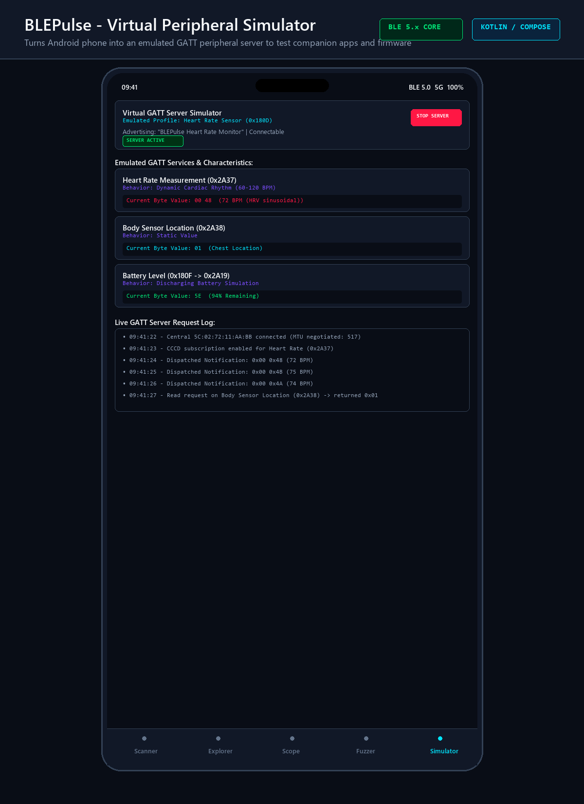
</p>

---

## Technical Architecture

```
                       +---------------------------------------+
                       |          Jetpack Compose UI           |
                       |  Scanner, Explorer, Scope, Tools, Sim |
                       +---------------------------------------+
                                           |
                       +---------------------------------------+
                       |           BleRepository               |
                       |       (Hardware Mode Switcher)        |
                       +---------------------------------------+
                                       /         \
                                      /           \
     +----------------------------------+     +----------------------------------+
     |    AndroidBleHardwareProvider    |     |    VirtualBleHardwareProvider    |
     |   - BluetoothLeScanner           |     |   - ESP32-S3 Waveform Node       |
     |   - GattOperationQueue           |     |   - Polar H10 Heart Rate         |
     |   - Android 12+ Permission Guard |     |   - RuuviTag Weather Beacon      |
     |   - MTU 517 / PHY 2M Manager     |     |   - Vulnerable Fuzz Target       |
     +----------------------------------+     +----------------------------------+
                       |                                       |
                       +-------------------+-------------------+
                                           |
     +-------------------------------------------------------------------------+
     |                            Specialized Engines                          |
     |  - PcapExporter (Libpcap 2.4 DLT 251)   - FotaManager (Nordic & ESP32)  |
     |  - BleTerminalEngine (NUS/SPP Serial)   - FftAnalyzer (Radix-2 FFT)     |
     |  - GeigerProximityTracker (PCM Audio)   - BleSecurityAuditor (Heuristic)|
     |  - GattMacroEngine (Automated Tests)    - GattFuzzerEngine (Mutations)  |
     +-------------------------------------------------------------------------+
```

---

## Getting Started

### Prerequisites
- Android Studio Ladybug (2024.2+) or IntelliJ IDEA with Android plugin.
- Android SDK with Platform 35 (`compileSdk = 35`, `minSdk = 26`).
- JDK 17 or JDK 21.

### Build and Run Unit Tests
```bash
# Run the complete test suite (32 unit tests)
./gradlew testDebugUnitTest

# Assemble the signed debug APK
./gradlew assembleDebug
```

The compiled APK will be located at:
```
app/build/outputs/apk/debug/app-debug.apk
```

### Installation via ADB
```bash
adb install -r app/build/outputs/apk/debug/app-debug.apk
```

---

## Offline and Simulator Mode

BLEPulse includes an offline hardware simulation layer. When testing on emulators or environments without physical Bluetooth LE adapters, toggle the mode pill in the Scanner toolbar to **VIRTUAL**. 

The virtual provider exposes 5 synthetic devices:
1. `ESP32-S3 Waveform Node` (Nordic UART Service streaming 3-channel accelerometer data).
2. `Polar H10 3BA244` (Heart Rate Monitor broadcasting dynamic cardiac intervals).
3. `iBeacon Asset Tag` (Apple proximity broadcast tag with calibrated TxPower).
4. `RuuviTag CA58` (Environmental weather station).
5. `IoT Fuzz Target` (Microcontroller with a 64-byte buffer threshold).

---

## License

This project is licensed under the MIT License. See [LICENSE](LICENSE) for details.
